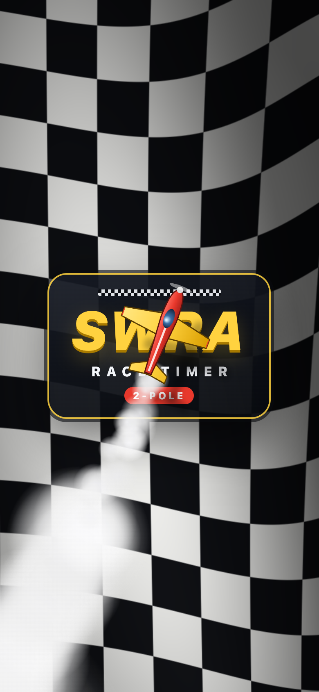
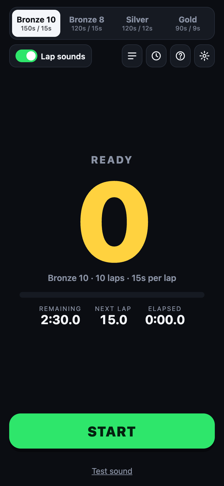
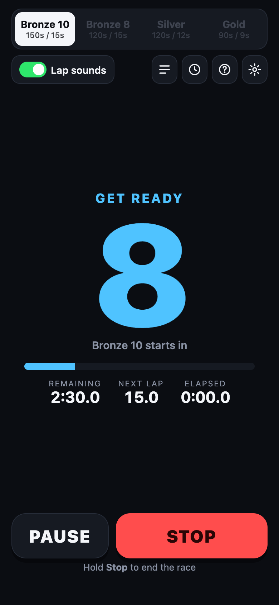
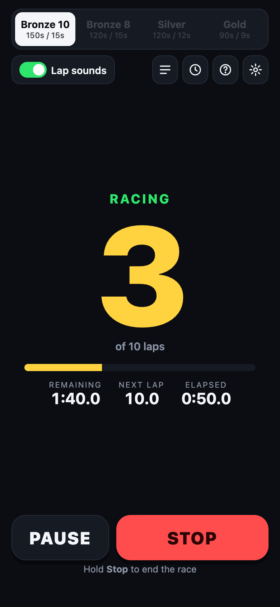
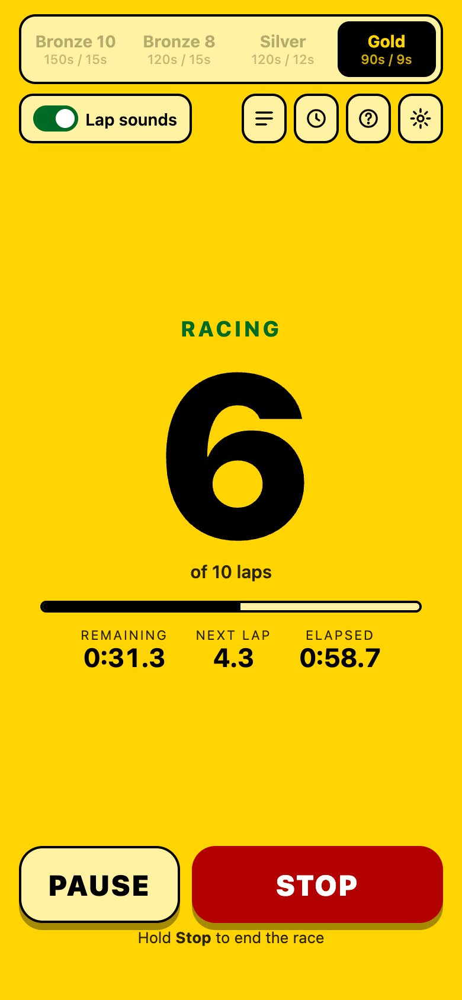
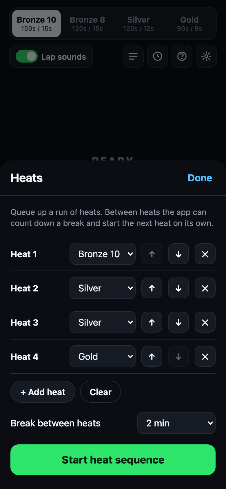
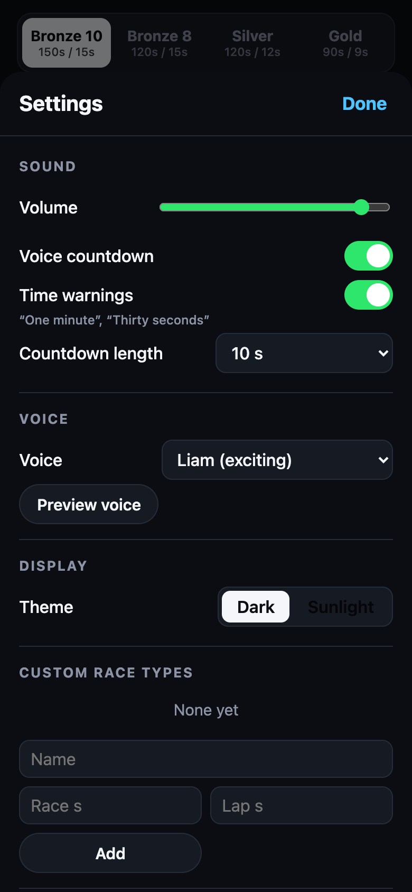
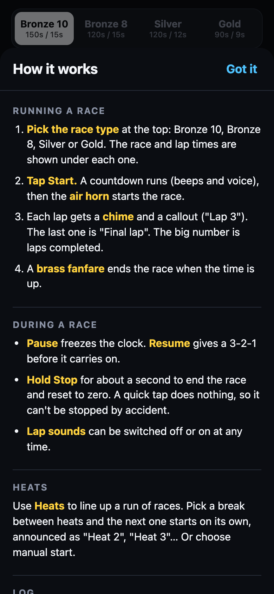

# SWRA Race Timer

Race timer for SWRA 2-pole RC pylon races. It runs the countdown, plays lap tones with spoken callouts, starts the race with an air horn, and handles heats and a race log. It's a web app you install on a phone or tablet, works offline, and plays through any Bluetooth speaker.

**Open it:** https://asosick.github.io/swra-rc-racetimer/

<table>
  <tr>
    <td align="center"><br><sub>Loading screen</sub></td>
    <td align="center"><br><sub>Ready</sub></td>
    <td align="center"><br><sub>Countdown</sub></td>
    <td align="center"><br><sub>Racing</sub></td>
  </tr>
  <tr>
    <td align="center"><br><sub>Sunlight theme</sub></td>
    <td align="center"><br><sub>Heats</sub></td>
    <td align="center"><br><sub>Settings</sub></td>
    <td align="center"><br><sub>Help</sub></td>
  </tr>
</table>

## Races

| Race      | Length | Lap tone every | Laps |
|-----------|--------|----------------|------|
| Bronze 10 | 150 s  | 15 s           | 10   |
| Bronze 8  | 120 s  | 15 s           | 8    |
| Silver    | 120 s  | 12 s           | 10   |
| Gold      | 90 s   | 9 s            | 10   |

**Start** runs a countdown (10 s by default, or off in Settings): a beep and a spoken number each second, then "Go!" with a long tone. With **Lap sounds** on, each lap plays a short beep and then "Lap 1", "Lap 2"… The last lap is called as "Final lap". The race starts with a real stadium air horn and ends with a brass fanfare. The countdown ticks are soft marimba-style, the last three are bells, and the lap tone is a two-note chime. Everything except the air horn is synthesized in the browser.

Air horn: "Gas fog horn #2" by Joseph Sardin, [BigSoundBank](https://bigsoundbank.com/gas-fog-horn-2-s1049.html), CC0 (public domain). The app uses the first blast, trimmed and normalised, in `app/sounds/airhorn.m4a`.

During a race:

- **Pause / Resume**: pause freezes the clock and says "Race paused". Resume plays a 3-2-1-go lead-in, then the race continues where it stopped.
- **Hold Stop** (about 1 second) to end the race and reset to zero. A quick tap does nothing, so a race can't be stopped by accident.
- The screen shows the lap count, time remaining, time to the next lap, and time elapsed.

Other features:

- **Heats**: queue up a run of heats (any mix of race types). Set a break between heats (30 s to 5 min) and the next heat starts on its own, announced as "Heat 3" before its countdown. You can also choose manual start.
- **Race log**: every finished or stopped race is saved on the phone. Share it as text or download it as CSV.
- **Help**: the **?** button explains everything, and it opens by itself on first launch.
- **Install prompt**: from the second launch on, a small card offers to install the app. "Not now" hides it for two weeks, and it stops asking after three dismissals.
- **Settings are remembered** on the device between launches.
- **Settings**: volume, voice countdown on/off, time warnings ("One minute", "Thirty seconds") on/off, countdown length, recorded voice or the phone's own voice (with speed), a dark or sunlight (black-on-yellow) theme, and custom race types.

### Voice clips

Spoken callouts use recorded clips, scheduled on the audio clock for exact timing. There are two sets, and you pick one in **Settings → Voice**:

- **Liam (exciting)**, `app/voice/liam/`: ElevenLabs voice "Liam" on the `eleven_v4` model, with excited/shouting delivery. Voice by [ElevenLabs](https://elevenlabs.io), generated on the free plan, which requires this credit and non-commercial use.
- **Classic (calm)**, `app/voice/classic/`: macOS "Samantha" voice. Apple's licence for system voices is aimed at personal use.

You can also pick one of the phone's own voices; the app also falls back to the phone's voice if a clip is missing.

The clips are generated once with `tools/make-voice.sh` and committed, so they sound the same every time:

```bash
security add-generic-password -U -s swra-elevenlabs -a "$USER" -w   # store your ElevenLabs key in the Keychain (once)
tools/make-voice.sh elevenlabs                                     # -> app/voice/liam
tools/make-voice.sh say                                            # -> app/voice/classic
```

Countdown numbers longer than 0.8 s are sped up (keeping the pitch) so they fit between one-second beeps.

## Install on a phone

Open the site, then:

- **iPhone/iPad (Safari):** Share → Add to Home Screen.
- **Android (Chrome):** ⋮ menu → Install app (or Add to Home screen).

Pair the Bluetooth speaker in the phone's settings first; the app just plays to the current audio output. Use **Test sound** to check volume before a race.

## Develop

Everything is static files in `app/`. Serve it locally:

```bash
python3 -m http.server 8765 --directory app
```

When you change files in `app/`, bump `VERSION` in `app/sw.js` so installed copies update. In the browser console, `__race.skip(30)` fast-forwards a running race by 30 seconds for testing.

## Deploy

`.github/workflows/pages.yml` publishes `app/` to GitHub Pages on every push to `main`. One-time setup: repo **Settings → Pages → Source: GitHub Actions**.
